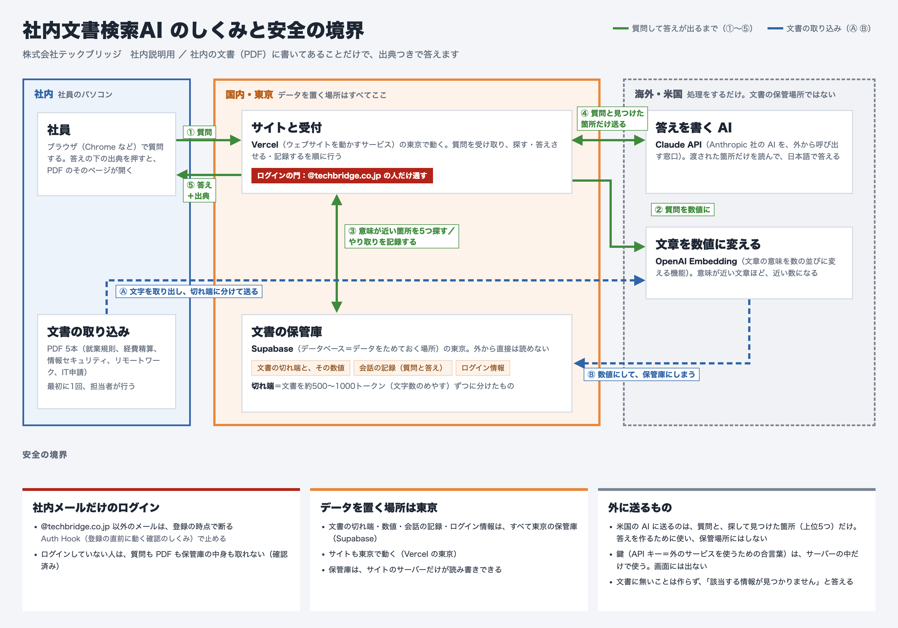

# 社内文書検索 AI

株式会社テックブリッジ向けの、社内文書に答えるチャットです。
社内の PDF に書いてあることだけで答え、答えの下に出典（ファイル名とページ）を出します。
文書に無いことは「該当する情報が見つかりません」と答えます。

- 本番: https://techbridge-doc-search.vercel.app
- 入れるのは `@techbridge.co.jp` のメールアドレスだけです

## しくみ



取り込み（最初に1回）

1. PDF から文字を取り出し、約500〜1000トークンの塊に分ける
2. 塊を OpenAI Embedding で数値にする
3. Supabase（東京）に保存する

質問されたとき

1. 質問を数値にする
2. Supabase で意味が近い塊を上位5件探す
3. Claude（Sonnet 4.6）が、その塊だけを読んで答える
4. 出典をつけて画面に返し、やり取りを `conversations` に記録する

## 使っているもの

| 役割 | 使うもの |
| --- | --- |
| 画面と受付 | Next.js 16（App Router）、Vercel の東京（`hnd1`） |
| 保管とログイン | Supabase（東京）、pgvector、Supabase Auth |
| 数値にする | OpenAI `text-embedding-3-small` |
| 答えを書く | Claude API `claude-sonnet-4-6` |

## 手元で動かす

Node.js 24 で動かしています。

```bash
npm install
npm run dev -- --port 3100
```

http://localhost:3100 を開き、「新規登録」から `@techbridge.co.jp` のアドレスで登録すると入れます。
確認メールは送らない設定です。

### .env

プロジェクト直下に `.env` を置きます。値は GitHub に上げません。

| 名前 | 使う場所 |
| --- | --- |
| `OPENAI_API_KEY` | 数値にする（サーバーだけ） |
| `ANTHROPIC_API_KEY` | 答えを書く（サーバーだけ） |
| `SUPABASE_URL` | サーバーから Supabase につなぐ |
| `SUPABASE_SERVICE_ROLE_KEY` | サーバーから保管庫を読み書きする（サーバーだけ） |
| `SUPABASE_DB_PASSWORD` | Supabase CLI でテーブルを作るとき |
| `NEXT_PUBLIC_SUPABASE_URL` | ブラウザのログイン |
| `NEXT_PUBLIC_SUPABASE_PUBLISHABLE_KEY` | ブラウザのログイン（公開してよい鍵） |

## よく使うコマンド

```bash
# PDF を塊に分ける（output/<名前>.chunks.json ができる）
node scripts/chunk-pdf.mjs case3-doc2-expense-manual.pdf

# 塊を数値にして Supabase に保存する
node --env-file=.env scripts/embed-and-store.mjs output/case3-doc2-expense-manual.chunks.json

# 画面を使わずに1問試す（会話の記録は残さない）
node --env-file=.env scripts/ask.mjs "在宅勤務手当はいくら？"
```

新しい PDF を足す手順と、答えがおかしいときの調べ方は [運用マニュアル.md](運用マニュアル.md) にあります。
PDF を足したときは `lib/documents.mjs` にも1行足します。ファイル名は `case3-` で始めます。

## ファイルの場所

| 場所 | 中身 |
| --- | --- |
| `app/page.jsx` | チャット画面 |
| `app/login/page.jsx` | ログイン画面 |
| `app/api/ask/route.js` | 質問の受け口。ログインを確かめてから答える |
| `app/api/pdf/[name]/route.js` | 出典の PDF を返す。ログインした人だけ |
| `proxy.js` | ログインしていない人をログイン画面へ送る |
| `lib/rag.mjs` | 探して答える処理（画面と `scripts/ask.mjs` で共通） |
| `lib/auth.mjs` | ログインとドメインの確認 |
| `lib/documents.mjs` | 取り込んだ PDF と、画面に出す文書名 |
| `scripts/` | 取り込みと、1問試すスクリプト |
| `supabase/migrations/` | テーブル、検索の関数、ドメインを絞る Auth Hook |
| `output/` | PDF を分けた塊 |

## 安全のための決まり

- 登録できるのは `@techbridge.co.jp` だけです。Supabase の Auth Hook で、登録の時点で断ります
- 質問と PDF の受け口は、ログインした `@techbridge.co.jp` の人だけに答えます
- テーブルは RLS をかけてあり、サーバーの鍵でしか読み書きできません
- 鍵はサーバーの中だけで使い、`.env` はコミットしません

## 公開

GitHub の `main` に上げると、Vercel が本番を作り直します。
本番の環境変数は Vercel に入っています。

## 資料

- [requirements.md](requirements.md): 要件
- [提案書.md](提案書.md): 今回の提案
- [Phase2提案書.md](Phase2提案書.md): 次の段階の機能と金額
- [運用マニュアル.md](運用マニュアル.md): 情報システム部向けの運用手順
- [architecture.png](architecture.png): 作業用の全体図
